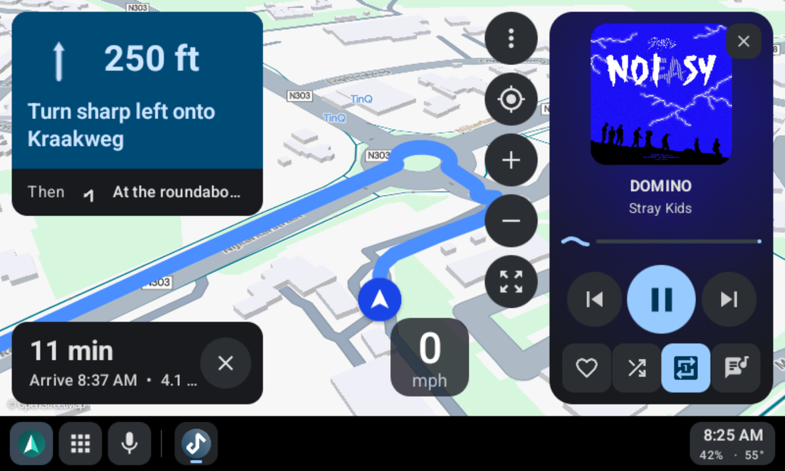
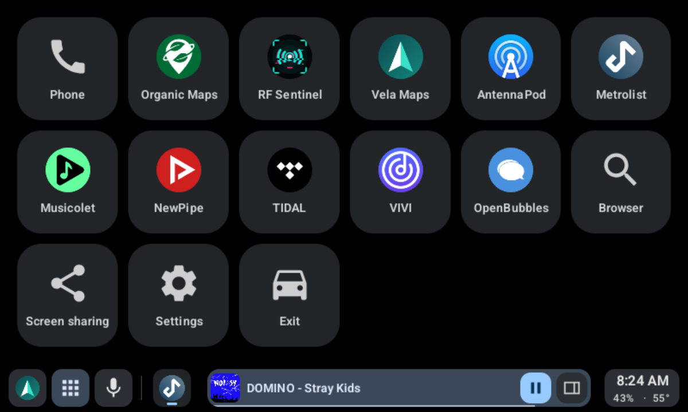
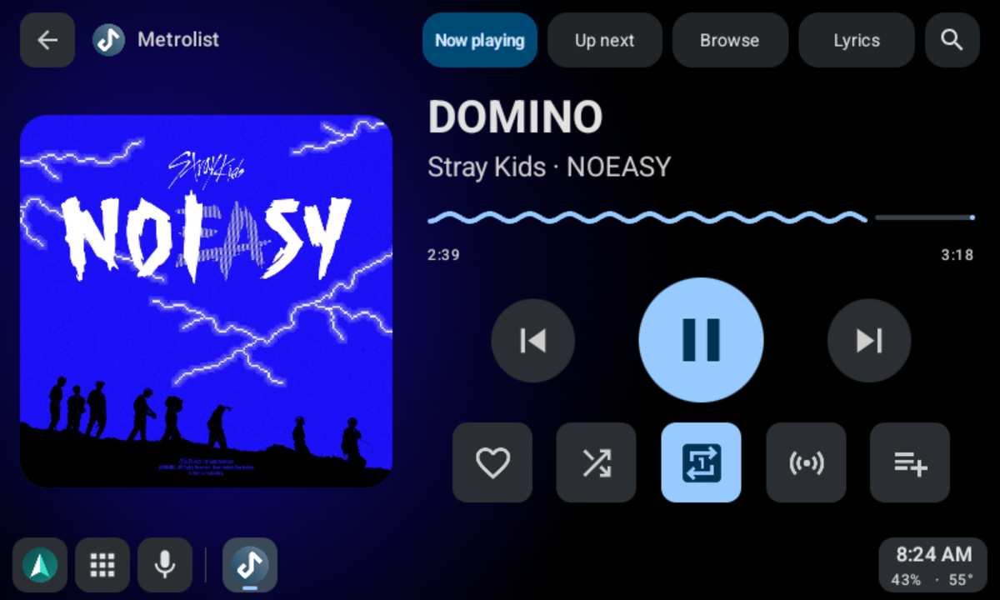
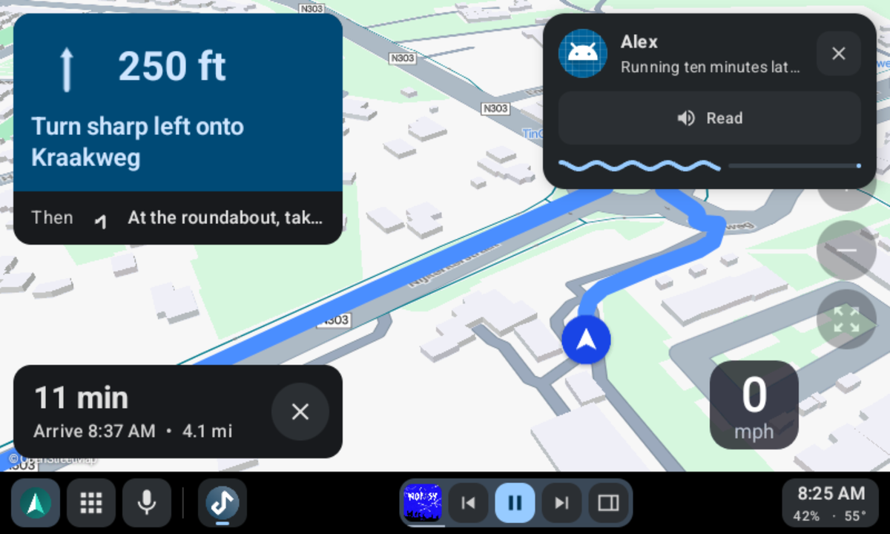
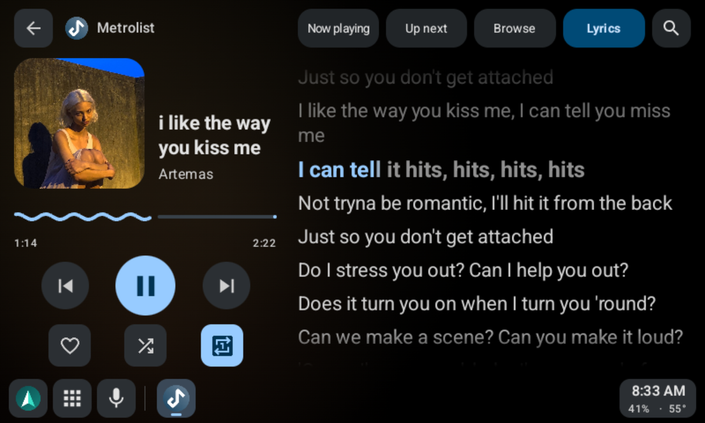
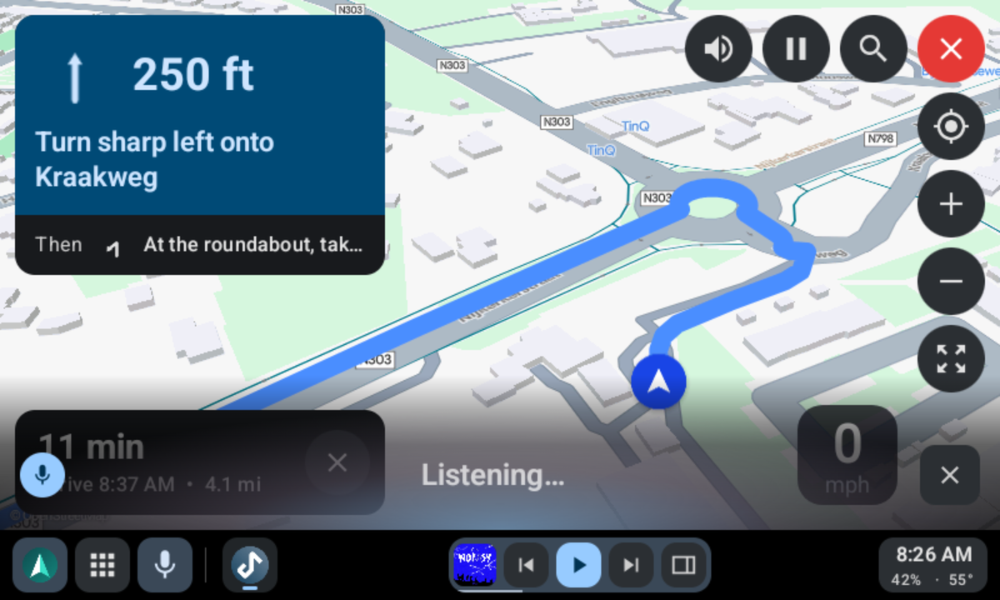
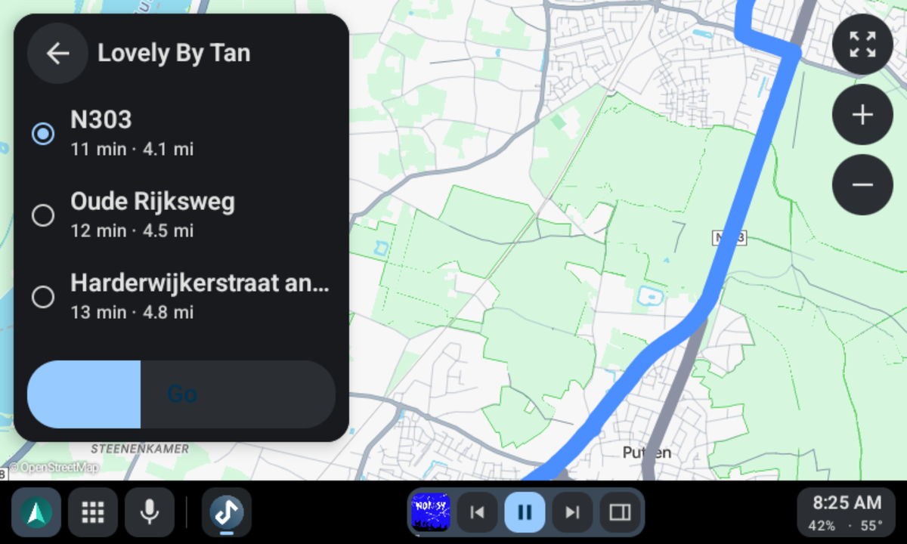
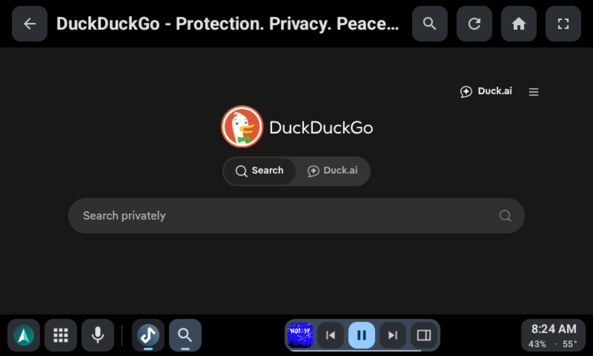

# Gearslip

An Android Auto alternative built for everyone.

[](https://apps.obtainium.imranr.dev/redirect?r=obtainium://add/https://github.com/twinksoftware/gearslip)
[](https://forthebadge.com)



Gearslip speaks the Android Auto protocol straight to your car, over USB or wireless, with no
Google software in the path. Map, music, and messaging apps draw their car screens through
Gearslip, and it adds a player, calls, voice, and a web browser of its own.

> [!WARNING]
> Gearslip is **alpha software**. It can drop the connection, freeze the car screen, or fail
> to start, and a new release can break a car that worked before. Set it up while parked, and
> keep another way to navigate.

Questions, ideas? [Join the discussion on Matrix](https://matrix.to/#/!mf0_mgBd5KqKpc9FfX_wHp1jFCcwAtPrndIn_oGIyMk?via=matrix.org).

## What works

| | |
|---|---|
| **Cars** | Most cars, over USB or wireless. Some cars from about 2020 on need a certificate of your own. [CARS.md](CARS.md) lists the cars drivers have confirmed. |
| **Maps** | Organic Maps, Vela, OsmAnd, Waze, Flitsmeister, MAPS.ME, and MapQuest on the car screen, alerts included. Turns from Google Maps or Waze on the phone show in the nav bar and on the instrument cluster. |
| **Music** | Any app built for car screens, with Now Playing, Up Next, search, and lyrics. Spotify plays through Gearslip's own player. |
| **Calls** | Dial or search contacts, and answer or decline on the car screen. Calls use the car's Bluetooth. |
| **Messages** | Read aloud on arrival, with a reply by voice or a quick reply. |
| **Voice** | "Navigate to the nearest gas station", "play Daft Punk", "call Mom". Speech stays on the phone. Commands are in English for now. |
| **Controls** | Touch, steering wheel buttons, control knobs, and D-pads. |
| **Languages** | English and 19 more, some only partly translated. |
| **Head units with Android** | Gearslip can be the home screen of an Android head unit, or of a spare phone or tablet on the dash. Turn on Use as launcher in Settings > Connection. |
| **Doesn't work** | Spotify's and Google Messages' own car screens, which accept only Android Auto. TIDAL lets only approved apps browse its library. |

## See it

| | |
|---|---|
|  |  |
| Your car apps in one place. | Metrolist in Gearslip's player. |
|  |  |
| A new message, read aloud at a tap, over the map. | Lyrics light up word by word as the song plays. |
|  |  |
| Ask for a place, a song, or an app. | Pick a route. Each one shows its time and distance. |
|  | |
| Browse the web while parked. | |

## Features

- **Navigation.** Gearslip hosts real map apps on the car screen. While you navigate, a big
  turn card shows the arrow, the distance, and your lane, and the map keeps the rest.
- **Music.** Browse, play, and queue from any car-ready media app. Type a search, and apps
  that accept one play the best match.
- **Phone calls.** During a call, the nav bar shows who you're talking to, and you mute or
  hang up from there.
- **Messages and notifications.** Only messages, missed calls, alarms, and reminders
  interrupt you. The rest wait on the dashboard. Music pauses while Gearslip speaks or
  listens.
- **Voice.** Tap the mic or press the talk button on the wheel. Say "help" for the full list.
- **The web.** A browser with an address bar, back and forward, and its own keyboard.
- **Weather and the day ahead.** A dashboard shows the week's calendar beside the weather.
- **Your apps, your order.** Apps group by kind. Press and hold one to move it, and hide
  the ones you don't use from the Apps card on the phone.
- **Your look.** The car screen takes your phone's Material You colors. Choose flat
  buttons or ones that look like real keys, and make text bigger on small screens.
- **Settings on the phone.** Set things up before you drive. A change on either screen
  shows on both.

## Install

1. Install Gearslip from [the releases page](https://github.com/twinksoftware/Gearslip/releases)
   or through Obtainium.
2. Open it. Setup asks where your Android Auto certificate comes from, then for one
   permission at a time, each with a plain reason. A help screen in the car answers the rest.
3. Plug the phone into the car's USB port. In a car with wireless Android Auto, pair the
   phone with the car over Bluetooth, then tap Connect wirelessly and pick the car.

After the first wireless drive, Android asks once whether Gearslip may watch for that car.
From then on, Gearslip connects whenever the car's Bluetooth does.

> [!NOTE]
> On GrapheneOS, make sure **USB-C port control** isn't set to **Charging-only**. That
> setting blocks USB data, so the car never sees the phone, even with a data cable.

Gearslip updates itself from this repository. Once a day it checks the latest release,
downloads the APK, checks it against GitHub's SHA-256, and installs it through Android's
own installer. Turn off automatic checks in Settings.

### Verify your download

Check that your copy of Gearslip is genuine with
[AppVerifier](https://github.com/soupslurpr/AppVerifier): share this block to it, or compare it
with the output of `apksigner verify --print-certs`.

```
app.seb3thehacker.gearslip
4C:C5:6E:BD:D1:3A:54:D2:60:EC:A9:B7:E2:B2:AE:6B:30:E2:F2:25:BF:DA:8F:50:8F:07:09:ED:F0:84:94:8B
```

## Good to know

- **Music reaches the car over Bluetooth or through Gearslip.** Setup asks which.
  Bluetooth is the default. Android never asks for permission, and your map app's voice
  reaches the car too. Through Gearslip, the sound travels over the car connection, cable
  or wireless. It sounds a little clearer, with no delay, but each drive Android asks you
  to share your screen, which lets Gearslip send the sound. Gearslip never reads the
  screen. Capturing playback is the only way an ordinary app can pass another app's audio
  along.
- **Gearslip needs no adb, root, or Shizuku.** Every feature relies on an ordinary
  Android permission or an on-device consent dialog. For audio through Gearslip, setup
  offers two optional adb commands. One removes the audio dialog for good, and the other
  keeps notifications visible while audio plays.
- **Apps without a car screen** can still reach the car through a separate screen-sharing
  mode.
- **Gearslip works with [LIVI](https://github.com/f-io/LIVI),** the open-source head unit
  used in homemade car dashboards.

## Usage notes

Gearslip can send short notes that show which cars it works in. They stay off unless you
turn them on, in setup or in Settings.

- **When they go out.** When you open Gearslip, at most once a day, and after each drive.
  Nothing runs in the background.
- **What they carry.** The Gearslip version and which boxes you ticked, plus whatever
  those boxes cover: the Android version and whether the phone runs GrapheneOS, the phone
  model, whether a car connected that day, and each car's head unit, model, year, screen
  size, and connection result, with whether that drive used the cable or wireless and
  whether music went through Gearslip or over Bluetooth. If you tick it, how each drive
  went: how far the connection got, how long it lasted, and how it ended. Settings shows
  the exact note. Untick a phone detail, and the server drops the copy it kept.
- **What they leave out.** Your name, accounts, location, contacts, messages, and
  anything you type or play.
- **How phones are counted.** A random number counts each phone once. The server keeps
  only a salted hash of it.
- **Where they go.** To Gearslip's server. Like any website, it sees your IP address when a
  note arrives, and it doesn't store it.

Turn the notes off, and they stop at once.

## Help out

Bug reports from real cars help most, and pull requests are welcome.
[CONTRIBUTING.md](CONTRIBUTING.md) explains what to put in a report, which branch to work
on, and the one-time agreement you sign before your first pull request merges.

To translate Gearslip into your language, join
[Gearslip on Weblate](https://hosted.weblate.org/engage/gearslip/). No coding needed.
Translations go through Weblate only, since it holds its own copy of every language and
changes made in git collide with it.

[](https://hosted.weblate.org/engage/gearslip/)

## How Gearslip is made

Gearslip is my beloved child. I decide what it does and how it looks, and Claude writes nearly
all of the code. I test every change myself before it ships: in a real car, with both a
GrapheneOS phone and a stock Android phone, and on [LIVI](https://github.com/f-io/LIVI), the
open-source head unit software. I watch the phone's temperature too, so a new feature doesn't
cook it. Then I beg my friends to try it in their cars, so it works in as many makes, models,
and years as possible. If something breaks, that's on me, so please open an issue.

## Building

```
./gradlew :gearslip:assembleDebug
```

The APK lands at `build/Gearslip-debug.apk`.

A release build needs a signing key. Copy `keystore.properties.example` to
`keystore.properties`, fill in your own values, and run
`./gradlew :gearslip:assembleRelease`. Git ignores both the properties file and the
keystore. Without them, the debug build still works.

## Writing apps for Gearslip

[docs/BUILDING_APPS.md](docs/BUILDING_APPS.md) specifies how to write apps that Gearslip
can render: templated apps, media apps, and the Gearslip app protocol.

## How Gearslip talks to cars

Gearslip is an independent program, written to work with car head units. What it knows of
the protocol comes from public open-source projects such as
[aasdk](https://github.com/opencardev/aasdk) and open-android-auto, and it contains none
of Google's Android Auto code.

Gearslip ships without a certificate. On first launch you choose where yours comes from:
download the one the aasdk project publishes, or import a file of your own. The
certificate stays on your phone. Gearslip never uploads, backs up, or logs it.

## Trademarks

Android, Android Auto, Google Messages, and Waze are trademarks of Google LLC. Spotify is
a trademark of Spotify AB. Gearslip is not affiliated with, endorsed by, or sponsored by
any of these companies. All other names belong to their owners.

## License

Gearslip belongs to Twink Software LLC and is licensed under AGPL-3.0; see [LICENSE](LICENSE).
The LLC also sells a separate commercial license for private use outside the AGPL's terms; see
[NOTICE.md](NOTICE.md).
