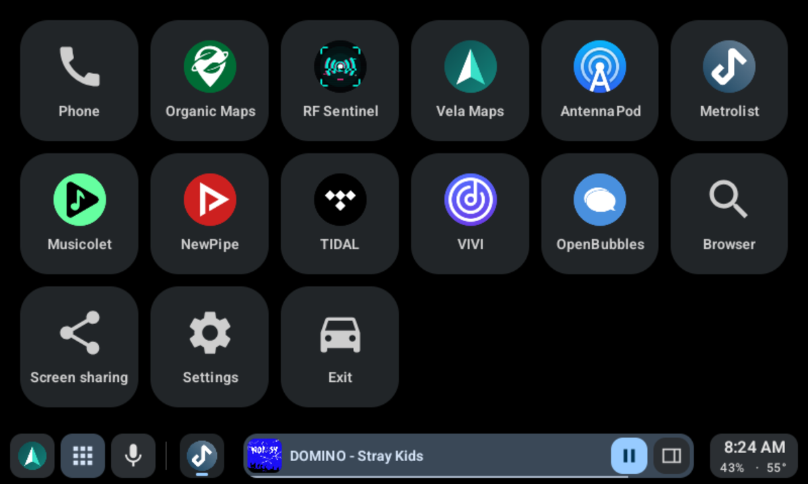
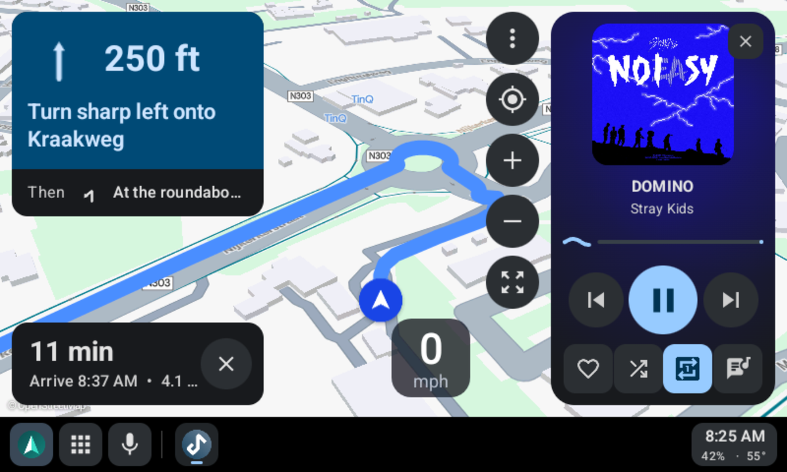
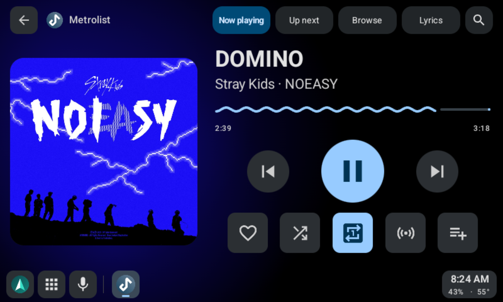
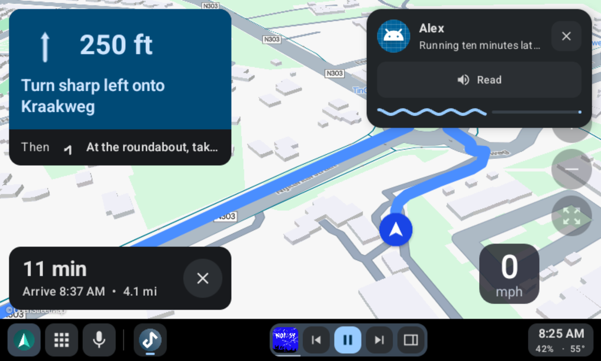
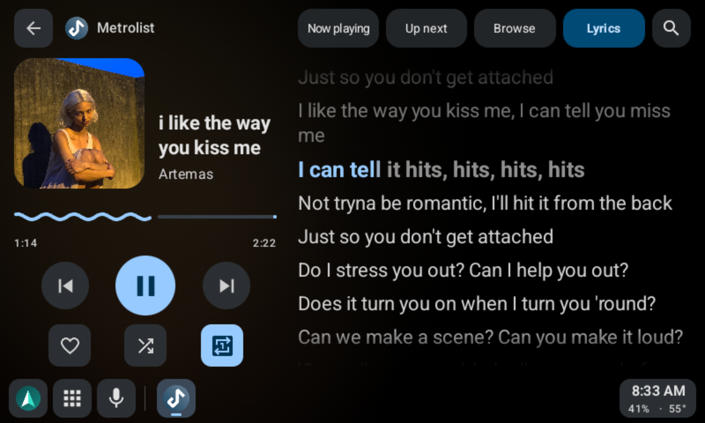
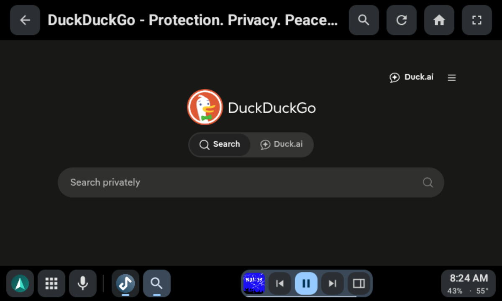
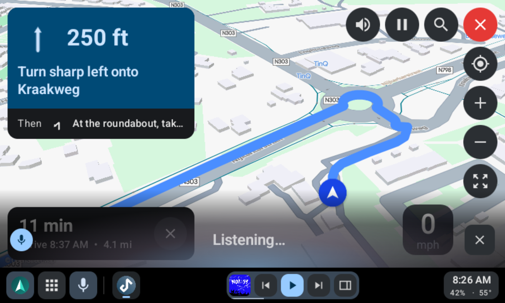
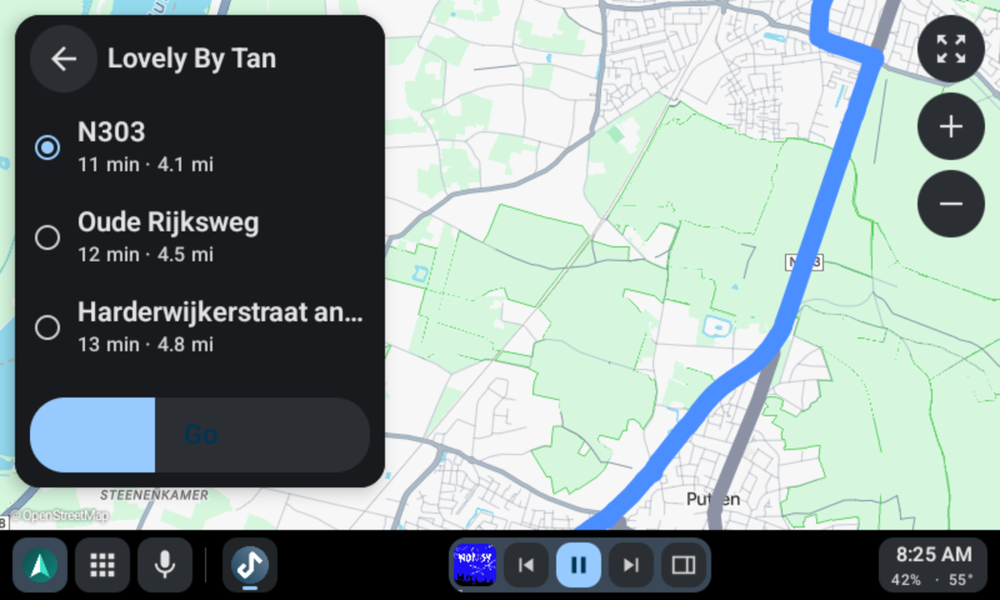

# Gearslip

An Android Auto alternative built for everyone.


[](https://forthebadge.com)

[](https://apps.obtainium.imranr.dev/redirect?r=obtainium://add/https://github.com/twinksoftware/gearslip)

[](https://hosted.weblate.org/engage/gearslip/)

Gearslip speaks English, Arabic, Chinese, Czech, Dutch, French, German, Italian, Japanese,
Korean, Polish, Portuguese, Russian, Spanish, Swedish, Turkish, and Ukrainian. Most of these
started as machine translations, so some read awkwardly.
[Fix or add your language on Weblate](https://hosted.weblate.org/engage/gearslip/).

Questions, ideas?
[Join the discussion on Matrix](https://matrix.to/#/!mf0_mgBd5KqKpc9FfX_wHp1jFCcwAtPrndIn_oGIyMk?via=matrix.org).

## Which cars work

Most cars work. Starting around 2020, some cars added newer security checks that reject
the aasdk certificate, and in those cars Gearslip needs a certificate of your own. [CARS.md](CARS.md) lists the
cars drivers have confirmed.

## What Gearslip is

Gearslip is an Android Auto client for the phone. It speaks the Android Auto protocol
directly to a car head unit, over USB or wirelessly, with no Google software in the path.
Gearslip acts as a Car App Library host: an app that ships a car interface hands Gearslip
a template, and Gearslip renders that template natively on the car screen. Nothing is
mirrored from the phone. For apps without a car interface, Gearslip offers a separate
screen-sharing mode.

| | |
|---|---|
|  |  |
| Your car apps in one place. | Vela Maps navigating, with the player beside it. |
|  |  |
| Metrolist in Gearslip's player. | A new message, read aloud at a tap, over the map. |
|  |  |
| Lyrics light up word by word as the song plays. | Browse the web while parked. |
|  |  |
| Ask for a place, a song, or an app. | Pick a route to a coffee shop. Each one shows its time and distance. |

## Features

- **Phone calls.** Dial from a keypad, or search your contacts, then confirm before the
  call goes out. When a call comes in, answer or decline it on the car screen. During a
  call, the nav bar shows who you're talking to, and you mute or hang up from there.
- **Navigation.** Gearslip hosts real Car App Library map apps on the car screen.
  Organic Maps, Vela, OsmAnd, Flitsmeister, MAPS.ME, and MapQuest work today. While you
  navigate, a big turn card on the left shows the arrow, the distance, and your lane, and
  the map keeps the right side.
- **Music.** Browse, play, and queue tracks from a car-enabled media app, with a Now
  Playing view, an Up Next queue, and lyrics. Type a search, and apps that accept one
  play the best match.
- **The web.** A browser with an address bar, back and forward, and its own on-screen
  keyboard, for anything that doesn't ship a car interface of its own.
- **Weather and the day ahead.** A dashboard screen shows the week's calendar next to
  the current and coming weather.
- **Voice.** Tap the mic, or press the talk button on the wheel, and say "navigate to the
  nearest gas station", "play Daft Punk", or "call Mom". Say "help" for the full list.
  Speech turns into text on the phone, and nothing you say leaves it.
- **Messages.** New messages appear as a small card on the car screen. Gearslip reads
  each one aloud, and you reply by voice or with a quick reply. Music pauses while
  Gearslip speaks or listens. Speech runs on the phone, so it needs no Google account.
- **Notifications.** Only messages, missed calls, alarms, and reminders interrupt you.
  The rest wait on the dashboard.
- **Your apps, your order.** The launcher groups apps by kind: phone, maps, music,
  messaging, and the rest. Press and hold an app to move it.
- **Car controls.** Steering wheel buttons, control knobs, and D-pads all work.
- **Your phone's colors.** The car screen and the phone app take their colors from your
  phone's Material You palette, and every card and button matches.
- **Themes.** Choose flat buttons or skeuomorphic ones that look like real keys.
- **Settings on the phone.** The car's settings sit on the phone's home screen too, so you
  can set things up before you drive. A change on either screen shows on both.

## Status

- **Wired or wireless.** Plug the phone into the car's USB port, or, in a car with wireless
  Android Auto, tap Connect wirelessly and pick the car. Pair the phone with the car over
  Bluetooth first. After the first wireless drive, Android asks once whether Gearslip may
  watch for that car; from then on, Gearslip connects whenever the car's Bluetooth does.
- **Setup walks you through it.** First launch asks for the Android Auto certificate,
  then one permission at a time, each with a plain reason and an Allow or Skip. A help
  screen inside the car answers anything setup didn't cover.
- **Templated apps work.** Gearslip renders the Car App Library's templates on the car
  screen, and it draws its own keyboard for search, sign-in, and text fields. It has been
  tested against several real navigation and media apps.
- **Gearslip works with [LIVI](https://github.com/f-io/LIVI),** the open-source head unit
  used in homemade car dashboards.
- **Some apps refuse Gearslip.** Spotify, Waze, and Google Messages use a version of
  Google's car library that accepts only Android Auto itself. Spotify still plays through
  Gearslip's own player. TIDAL lets only approved apps browse its library.
- **Calls use the car's Bluetooth,** as they do in Android Auto. Pair the phone with the
  car to hear calls through its speakers.
- **Music reaches the car over Bluetooth or through Gearslip.** Setup asks which.
  Bluetooth is the default: Android never asks for permission, and your map app's voice
  reaches the car too. Through Gearslip, the sound travels over the car connection, cable
  or wireless. It sounds a little clearer, with no delay, but each drive Android asks you
  to share your screen, which lets Gearslip send the sound. Gearslip never reads the
  screen; capturing playback is the only way an ordinary app can pass another app's audio
  along.
- **Gearslip needs no adb, root, or Shizuku.** Every feature relies on an ordinary
  Android permission or an on-device consent dialog. For audio through Gearslip, setup offers two
  optional adb commands: one removes the audio dialog for good, and the other keeps
  notifications visible while audio plays.
- **Updates come from GitHub.** Once a day, Gearslip checks this repository's latest
  release. When a new version is out, it downloads the APK, checks it against GitHub's
  SHA-256, and installs it through Android's own installer. Turn off automatic checks in
  Settings.

## Verify your download

Check that your copy of Gearslip is genuine with
[AppVerifier](https://github.com/soupslurpr/AppVerifier): share this block to it, or compare it
with the output of `apksigner verify --print-certs`.

```
app.seb3thehacker.gearslip
4C:C5:6E:BD:D1:3A:54:D2:60:EC:A9:B7:E2:B2:AE:6B:30:E2:F2:25:BF:DA:8F:50:8F:07:09:ED:F0:84:94:8B
```

## Usage notes

Gearslip can send short notes that show which cars it works in. They stay off unless you
turn them on, in setup or in Settings.

- **When they go out.** When you open Gearslip, at most once a day, and after each drive.
  Nothing runs in the background.
- **What they carry.** The Gearslip version and which boxes you ticked, plus whatever
  those boxes cover: the Android version and whether the phone runs GrapheneOS, the phone
  model, whether a car connected that day, and each car's head unit, model, year, screen
  size, and connection result, with whether that drive used the cable or wireless and
  whether music went through Gearslip or over Bluetooth. If you tick it, how each drive went: how far
  the connection got, how long it lasted, and how it ended. Settings shows the exact note. Untick a phone detail, and
  the server drops the copy it kept.
- **What they leave out.** Your name, accounts, location, contacts, messages, and
  anything you type or play.
- **How phones are counted.** A random number counts each phone once. The server keeps
  only a salted hash of it.
- **Where they go.** To Gearslip's server. Like any website, it sees your IP address when a
  note arrives, and it doesn't store it.

Turn the notes off, and they stop at once.

## How Gearslip is made

Gearslip is my beloved child. I decide what it does and how it looks, and Claude writes nearly
all of the code. I test every change myself before it ships: in a real car, with both a
GrapheneOS phone and a stock Android phone, and on [LIVI](https://github.com/f-io/LIVI), the
open-source head unit software. I watch the phone's temperature too, so a new feature doesn't
cook it. Then I beg my friends to try it in their cars, so it works in as many makes, models,
and years as possible. If something breaks, that's on me, so please open an issue.

## Contributing

Bug reports from real cars help most, and pull requests are welcome.
[CONTRIBUTING.md](CONTRIBUTING.md) explains what to put in a report, which branch to work
on, and the one-time agreement you sign before your first pull request merges.

To help translate Gearslip into your language, join
[Gearslip on Weblate](https://hosted.weblate.org/engage/gearslip/). No coding needed.

## Building

```
./gradlew :gearslip:assembleDebug
```

The APK lands at `build/Gearslip-debug.apk`.

A release build needs a signing key. Copy `keystore.properties.example` to
`keystore.properties`, fill in your own values, and run
`./gradlew :gearslip:assembleRelease`. Git ignores both the properties file and the
keystore. Without them, the debug build still works.

## Writing apps for Gearslip

[docs/BUILDING_APPS.md](docs/BUILDING_APPS.md) specifies how to write apps that Gearslip
can render: templated apps, media apps, and the Gearslip app protocol.

## How Gearslip talks to cars

Gearslip is an independent program, written to work with car head units. What it knows of
the protocol comes from public open-source projects such as
[aasdk](https://github.com/opencardev/aasdk) and open-android-auto, and it contains none
of Google's Android Auto code.

Gearslip ships without a certificate. On first launch you choose where yours comes from:
download the one the aasdk project publishes, or import a file of your own. The
certificate stays on your phone. Gearslip never uploads, backs up, or logs it.

## Trademarks

Android, Android Auto, Google Messages, and Waze are trademarks of Google LLC. Spotify is
a trademark of Spotify AB. Gearslip is not affiliated with, endorsed by, or sponsored by
any of these companies. All other names belong to their owners.

## License

Gearslip belongs to Twink Software LLC and is licensed under AGPL-3.0; see [LICENSE](LICENSE).
The LLC also sells a separate commercial license for private use outside the AGPL's terms; see
[NOTICE.md](NOTICE.md).
